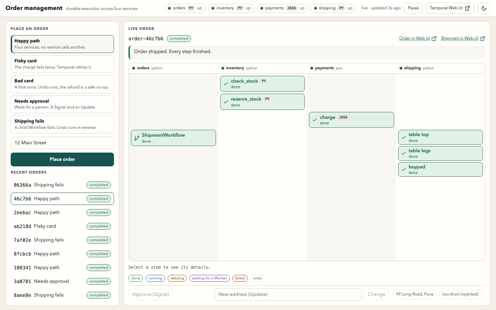
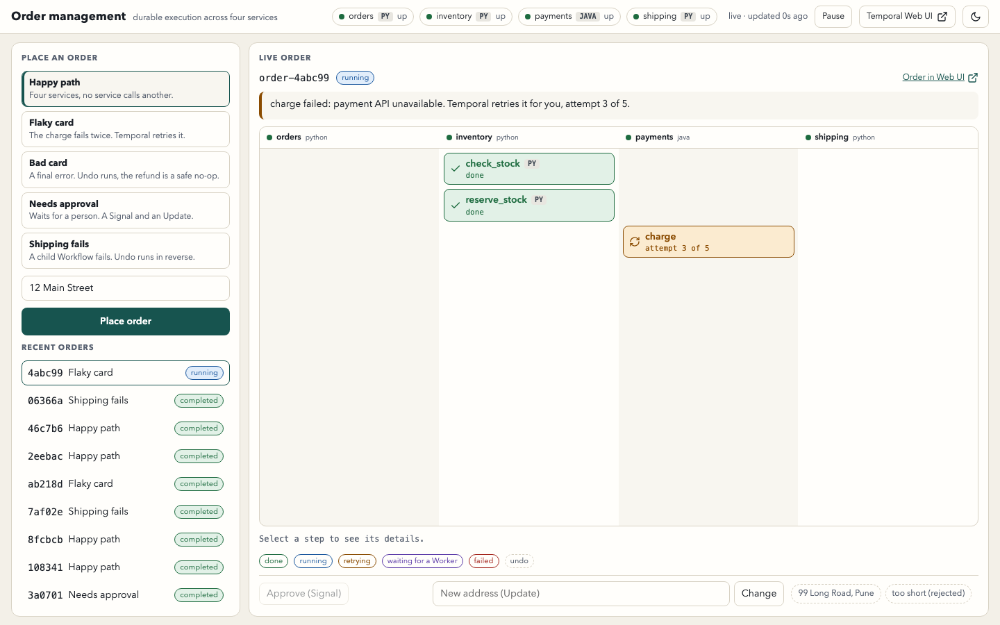
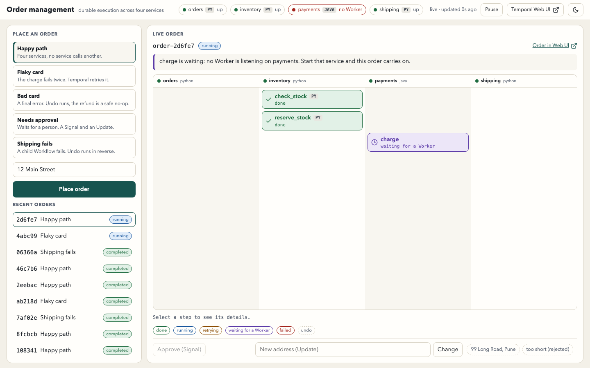
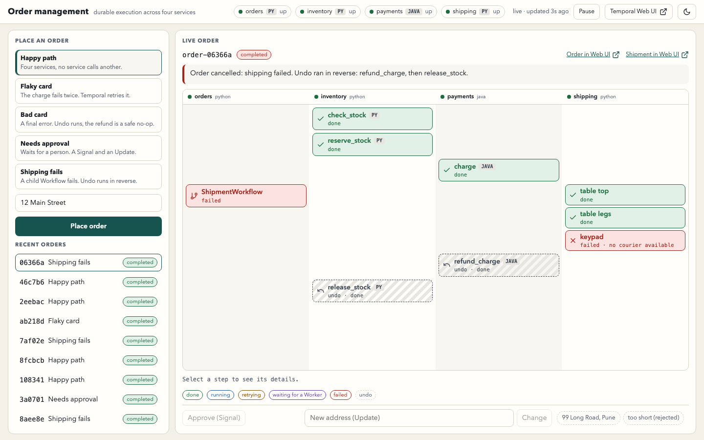
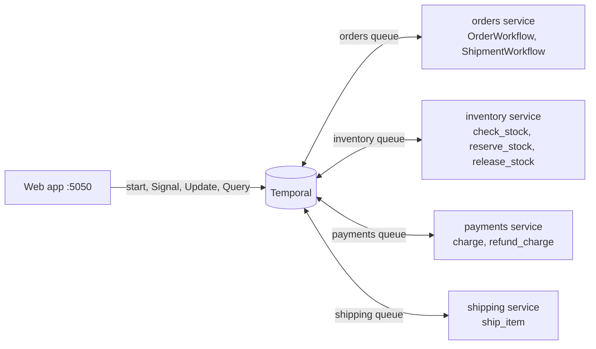
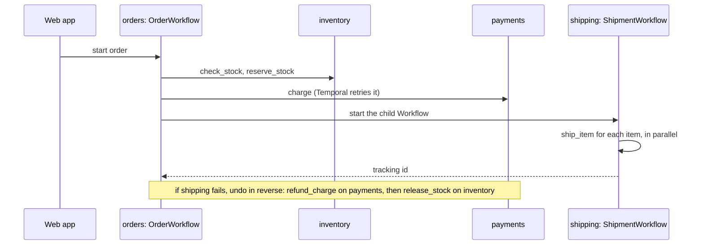

# Demo: order management with four services

A small web app places an order. The order runs through **four independent services**, each with its own Worker and task queue. Temporal runs the order Workflow and calls the other three. You can run each service in Python or in Java, and mix them.

Ideas from exercises [03](../../concepts/03-retries.md), [04](../../concepts/04-messages.md), [10](../../concepts/10-saga-across-services.md), [12](../../concepts/12-human-in-the-loop.md) and [13](../../concepts/13-fan-out-fan-in.md).

Inspired by [temporal-order-management-demo](https://github.com/temporal-sa/temporal-order-management-demo). This is a new, smaller implementation, not a copy.

Presenting it? Follow the [RUNBOOK](RUNBOOK.md).

## See it

| | |
|---|---|
|  |  |
| Each step sits in the lane of the service that ran it. Here `payments` is Java and the rest is Python. | The charge fails twice. Temporal retries it, and the page shows the attempt number and the error. |
|  |  |
| `payments` is stopped. The order waits at the charge and nothing is lost. | One item cannot ship. The order refunds the card, then releases the stock. |

## Quick start

You need the [Temporal CLI](https://docs.temporal.io/cli), and either Python 3.11+ with [uv](https://docs.astral.sh/uv/), or Java 21 with Maven.

```bash
cd demos/order-management
./run.sh python        # or: ./run.sh java, or ./run.sh mixed
```

Open http://localhost:5050. The Temporal Web UI is at http://localhost:8233. The script starts the Temporal dev server if it is not running, each of the four services as its own process, and the web app.

| Command | What it does |
|---|---|
| `./run.sh python` / `java` / `mixed` | start everything in Python, in Java, or with `payments` in Java and the rest in Python |
| `./run.sh status` | show what is running |
| `./run.sh stop payments` | stop one service (Worker) |
| `./run.sh start payments java` | start one service, in `python` (the default) or `java` |
| `./run.sh logs` | show the end of every log |
| `./run.sh smoke` | place an order for every scenario and check the result, add `--chaos` to also stop and start `payments` |
| `./run.sh down` | stop everything this script started |

### What the page shows

| On the page | What it teaches |
|---|---|
| Four service lanes, one chip per step | the Workflow calls each service by its task queue, and no service calls another |
| A **PY** or **JAVA** badge on each step and each lane | services can be written in different languages and still work together |
| A chip that reads *attempt 2 of 5* with the error | Temporal retries failed Activities for you |
| A purple *waiting for a Worker* chip and a red service chip | a service can be down without losing the order |
| Dashed, hatched undo chips in reverse order | the Saga: undo earlier steps when a later one fails |
| The child Workflow with its three `ship_item` calls | a child Workflow and Activities running in parallel |
| Approve, Change address, and a countdown | a Signal, an Update that can be rejected, and a Timer |
| Recent orders, and `?order=<id>` in the address bar | every order is a Workflow you can find and reopen |

The page reads its data from three endpoints that both apps offer: `/timeline/<id>` (the Event History and any pending Activity), `/services` (which queues have a Worker, from the Worker identity `python-<service>` or `java-<service>`) and `/orders`. It reads history from Temporal, so it keeps working when a service is stopped.

## How the services fit together



| Service | Task queue | Holds | Kind | Called by |
|---|---|---|---|---|
| orders | `orders` | `OrderWorkflow`, `ShipmentWorkflow` | 2 Workflows, no Activities | the web app |
| inventory | `inventory` | `check_stock`, `reserve_stock`, `release_stock` | 3 Activities | `OrderWorkflow` |
| payments | `payments` | `charge`, `refund_charge` | 2 Activities | `OrderWorkflow` |
| shipping | `shipping` | `ship_item` | 1 Activity | `ShipmentWorkflow`, once per item in parallel |

A service is a Worker listening on one task queue. It holds Activities (or, for `orders`, Workflows). A service is not itself an Activity.

| Part | Address |
|---|---|
| Web app (Python or Java) | http://localhost:5050 |
| Temporal server | `localhost:7233` |
| Temporal Web UI | http://localhost:8233 |



### The words used here

| Word | Meaning in this demo | Example |
|---|---|---|
| Workflow | the plan for one order. It decides what happens next and does no real work itself | `OrderWorkflow` |
| Child Workflow | a Workflow started by another Workflow, with its own history | `ShipmentWorkflow`, ID `ship-<order id>` |
| Activity | one step that does real work. It can fail and be retried | `charge`, `ship_item` |
| Service | a Worker plus its task queue | `payments` |
| Task queue | the mailbox Temporal uses to hand work to a service | `payments` |
| Worker | the program that listens at a queue and runs the work | each terminal window |
| Signal | a message that tells a running Workflow something, no answer back | `approve` |
| Update | a message that changes a running Workflow and returns an answer, and can be rejected | `change_address` |
| Query | a read-only question to a running Workflow | `status` |
| Retry Policy | how Temporal retries a failed Activity | `charge` fails twice, then passes |
| Saga | undoing earlier steps, in reverse order, when a later step fails | `refund_charge` then `release_stock` after shipping fails |

### One order, step by step

| # | What happens | Runs in | Queue | Kind |
|---|---|---|---|---|
| 1 | the web app starts the order | web app, then Temporal | none | start Workflow |
| 2 | check stock | inventory | `inventory` | Activity |
| 3 | reserve stock | inventory | `inventory` | Activity |
| 4 | wait for approval (**Needs approval** only) | `orders` | none | Workflow waits for a Signal |
| 5 | charge the card | payments | `payments` | Activity |
| 6 | start the shipment | `orders` | `orders` | child Workflow |
| 7 | ship the 3 items at the same time | shipping | `shipping` | 3 Activities |
| 8 | the order is done | `orders` | none | Workflow returns |

If step 5 fails for good (a declined card), the order undoes its steps in reverse. The undo for the charge is registered before the charge, because a charge can land even when the call fails. Here no money moved, so `refund_charge` finds nothing to refund and does nothing, then `release_stock` frees the stock. Steps 6 and 7 never run, so no `ship-<id>` appears.

If step 7 fails (**Shipping fails**), the child Workflow fails and the order undoes its steps in reverse: `refund_charge` on `payments`, then `release_stock` on `inventory`. Here `ship-<id>` exists and shows as failed.

What this shows about microservices:
- **Services never call each other.** The Workflow calls each one by its task queue, so there is no service-to-service HTTP, no queue wiring and no retry code in the services.
- **A service can be down without losing the order.** Stop `payments` and an order waits at "charging card". Start it again and the order carries on. Try it below.
- **Each service can use a different language.** The queue and Activity names are the contract. Python and Java services work together.
- **Undo is the Workflow's job.** If something fails, the Workflow tells the earlier services to undo their work, in reverse order (Saga, as in exercise 10). Try **Shipping fails**: the card is refunded, then the stock is released.

## Run it by hand

The `./run.sh` script above does all of this for you. These are the steps behind it.

**Terminal 1: Temporal**
```bash
temporal server start-dev              # Web UI at http://localhost:8233
```

**Terminal 2: the web app.** Pick one. They serve the same page on port 5050.
```bash
cd demos/order-management/python && uv run python app.py     # Python
cd demos/order-management/java && mvn -q compile exec:java@app   # Java
```
Open http://localhost:5050. The web app is only a Temporal client, so it works with Workers in either language.

**Terminal 3: the services.** Pick one.

| | Python | Java |
|---|---|---|
| All four in one process | `uv run python worker.py` | `mvn -q compile exec:java@worker` |
| Only some | `uv run python worker.py payments shipping` | `mvn -q compile exec:java@worker -Dexec.args="payments shipping"` |

Run Python commands from `demos/order-management/python` and Java commands from `demos/order-management/java`. Each queue should have one Worker, so do not start the same service in both languages.

## Run each service on its own (the microservices way)

Use one terminal per service. This mixes the languages: three in Python, `payments` in Java.

```bash
cd demos/order-management/python
uv run python worker.py orders         # terminal 3
uv run python worker.py inventory      # terminal 4
uv run python worker.py shipping       # terminal 5

cd demos/order-management/java
mvn -q compile exec:java@worker -Dexec.args="payments"    # terminal 6
```

## Try this: a service goes down

1. `./run.sh python`, open http://localhost:5050 and place a **Happy path** order. It ships.
2. `./run.sh stop payments`
3. Place another order. Within about five seconds the `charge` chip turns purple (*waiting for a Worker*) and the `payments` chip at the top turns red. In the Web UI the `charge` Activity is scheduled, with no Worker on `payments`.
4. `./run.sh start payments`. The same order finishes. Nothing was lost and nothing was retried by hand.
5. Try `./run.sh start payments java` after stopping it: the badge on the `charge` chip now says JAVA.

The red chip needs work waiting for it. With no orders in flight, the server only learns a Worker is gone after about a minute.

## Scenarios

| Pick | What happens | What it teaches | Where to look in the Web UI |
|---|---|---|---|
| Happy path | stock, charge, then a child Workflow ships the three items in parallel | services work together without calling each other | `order-<id>` and its child `ship-<id>` |
| Flaky card | the charge fails twice, the Retry Policy makes attempt 3 pass | Temporal retries for you, no retry loop in your code | the `charge` Activity shows 3 attempts |
| Bad card | non-retryable error, the undo steps run: the refund finds no charge, the reserved stock is released, order cancelled | some errors must not be retried, so earlier steps are undone (Saga), and an undo must be safe to run when there is nothing to undo | `refund_charge` and `release_stock` run after `charge` fails |
| Needs approval | the Workflow waits for a Signal, an Update can change the address first | a Workflow can wait for a person without using a thread | click Approve, or Change address (a short address is rejected) |
| Shipping fails | the card is charged, then one item cannot ship, so the child Workflow fails | a full Saga: undo in reverse order, `refund_charge` then `release_stock` | the order's history, and `ship-<id>` showing Failed |

## Test

No server is needed for the Java tests. Both run the same eight scenario tests (one per scenario, plus the approval timeout, the address Update and a rejected address). The Java project also has six web app tests (the page, the order, the address Update, and the timeline: steps, undo order, countdown). The Python project also has six tests of the data the page reads (`/timeline`, `/services`, `/orders`), which start a local Temporal server on their own, so the first run takes a few seconds longer.

```bash
cd demos/order-management/python && uv run pytest -q
cd demos/order-management/java && mvn -q test
./run.sh python && ./run.sh smoke --chaos && ./run.sh down     # the whole demo, end to end
```

Java has no tests for `/services`, the waiting state and `/orders`: its in-process test server cannot describe task queues or list Workflows. `./run.sh smoke` covers them in both languages.

## Troubleshooting

- **Order stuck at the first step:** no Worker is polling the `orders` queue. Start the services. The Web UI shows "No workers polling" for that queue.
- **Order stuck at one step:** the service for that step is not running. Check the queue in the Web UI under Task Queues.
- **Port 5050 in use:** macOS uses port 5000 for AirPlay, so the app uses 5050.
- **Edited the code and nothing changed:** restart the Workers. Running Workers keep the old code.

## Files

- `run.sh`, `smoke.py`: start and stop the whole demo, and check every scenario end to end
- `RUNBOOK.md`: how to present it, beat by beat
- `python/workflows.py`: `OrderWorkflow` and `ShipmentWorkflow`, with the task queue on every Activity call
- `python/activities.py`: the services' Activities, all simulated
- `python/worker.py`: one Worker per service, `SERVICES` lists them
- `python/app.py`, `python/timeline.py`, `python/templates/index.html`: the web app, the data it reads, and the page
- `java/src/main/java/demo`: the same services and web app in Java, one interface and class per service, and `Timeline.java`
- `python/tests`, `java/src/test`: one test per scenario, and tests of the data the page reads
- `docs/`: screenshots used above
