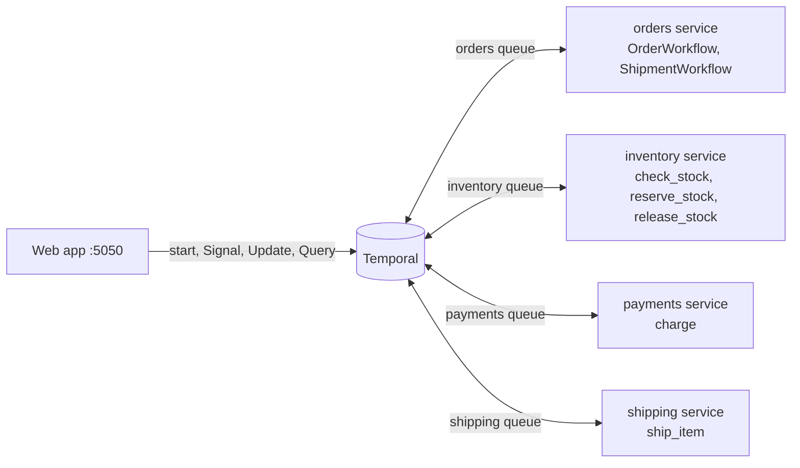

# Demo: order management with four services

A small web app places an order. The order runs through **four independent services**, each with its own Worker and task queue. Temporal runs the order Workflow and calls the other three. You can run each service in Python or in Java, and mix them.

Ideas from exercises [03](../../concepts/03-retries.md), [04](../../concepts/04-messages.md), [10](../../concepts/10-saga-across-services.md), [12](../../concepts/12-human-in-the-loop.md) and [13](../../concepts/13-fan-out-fan-in.md).

Inspired by [temporal-order-management-demo](https://github.com/temporal-sa/temporal-order-management-demo). This is a new, smaller implementation, not a copy.

## How the services fit together



| Service | Task queue | Owns | Called by |
|---|---|---|---|
| orders | `orders` | the Workflows: `OrderWorkflow` and its child `ShipmentWorkflow` | the web app |
| inventory | `inventory` | `check_stock`, `reserve_stock`, `release_stock` | `OrderWorkflow` |
| payments | `payments` | `charge` | `OrderWorkflow` |
| shipping | `shipping` | `ship_item` | `ShipmentWorkflow`, once per item in parallel |

What this shows about microservices:
- **Services never call each other.** The Workflow calls each one by its task queue, so there is no service-to-service HTTP, no queue wiring and no retry code in the services.
- **A service can be down without losing the order.** Stop `payments` and an order waits at "charging card". Start it again and the order carries on. Try it below.
- **Each service can use a different language.** The queue and Activity names are the contract. Python and Java services work together.
- **Undo is the Workflow's job.** If the card is declined, the Workflow tells `inventory` to release the stock (Saga, as in exercise 10).

## Run it

You need the [Temporal CLI](https://docs.temporal.io/cli), and either Python 3.11+ with [uv](https://docs.astral.sh/uv/), or Java 21 with Maven.

**Terminal 1: Temporal**
```bash
temporal server start-dev              # Web UI at http://localhost:8233
```

**Terminal 2: the web app.** Pick one. They serve the same page on port 5050.
```bash
cd demos/order-management/python && uv run python app.py     # Python
cd demos/order-management/java && mvn -q compile exec:java@app   # Java
```
Open http://localhost:5050. The web app is only a Temporal client, so it works with Workers in either language.

**Terminal 3: the services.** Pick one.

| | Python | Java |
|---|---|---|
| All four in one process | `uv run python worker.py` | `mvn -q compile exec:java@worker` |
| Only some | `uv run python worker.py payments shipping` | `mvn -q compile exec:java@worker -Dexec.args="payments shipping"` |

Run Python commands from `demos/order-management/python` and Java commands from `demos/order-management/java`. Each queue should have one Worker, so do not start the same service in both languages.

## Run each service on its own (the microservices way)

Use one terminal per service. This mixes the languages: three in Python, `payments` in Java.

```bash
cd demos/order-management/python
uv run python worker.py orders         # terminal 3
uv run python worker.py inventory      # terminal 4
uv run python worker.py shipping       # terminal 5

cd demos/order-management/java
mvn -q compile exec:java@worker -Dexec.args="payments"    # terminal 6
```

## Try this: a service goes down

1. Start all four services and the web app. Place a **Happy path** order. It ships.
2. Stop `payments` (Ctrl+C in its terminal).
3. Place another order. It stops at **Charge card** and stays running. In the Web UI the `charge` Activity is scheduled and waiting, with no Worker on `payments`.
4. Start `payments` again. The same order finishes. Nothing was lost and nothing was retried by hand.

## Scenarios

| Pick | What happens | Where to look in the Web UI |
|---|---|---|
| Happy path | stock, charge, then a child Workflow ships the three items in parallel | `order-<id>` and its child `ship-<id>` |
| Flaky card | the charge fails twice, the Retry Policy makes attempt 3 pass | the `charge` Activity shows 3 attempts |
| Bad card | non-retryable error, the reserved stock is released (Saga), order cancelled | `release_stock` runs after `charge` fails |
| Needs approval | the Workflow waits for a Signal, an Update can change the address first | click Approve, or Change address (a short address is rejected) |

## Test

No server needed. Both run the same seven scenarios, and the Java project also tests its web app.

```bash
cd demos/order-management/python && uv run pytest -q
cd demos/order-management/java && mvn -q test
```

## Troubleshooting

- **Order stuck at the first step:** no Worker is polling the `orders` queue. Start the services. The Web UI shows "No workers polling" for that queue.
- **Order stuck at one step:** the service for that step is not running. Check the queue in the Web UI under Task Queues.
- **Port 5050 in use:** macOS uses port 5000 for AirPlay, so the app uses 5050.
- **Edited the code and nothing changed:** restart the Workers. Running Workers keep the old code.

## Files

- `python/workflows.py`: `OrderWorkflow` and `ShipmentWorkflow`, with the task queue on every Activity call
- `python/activities.py`: the services' Activities, all simulated
- `python/worker.py`: one Worker per service, `SERVICES` lists them
- `python/app.py`, `python/templates/index.html`: the web app
- `java/src/main/java/demo`: the same services and web app in Java, one interface and class per service
- `python/tests`, `java/src/test`: one test per scenario
